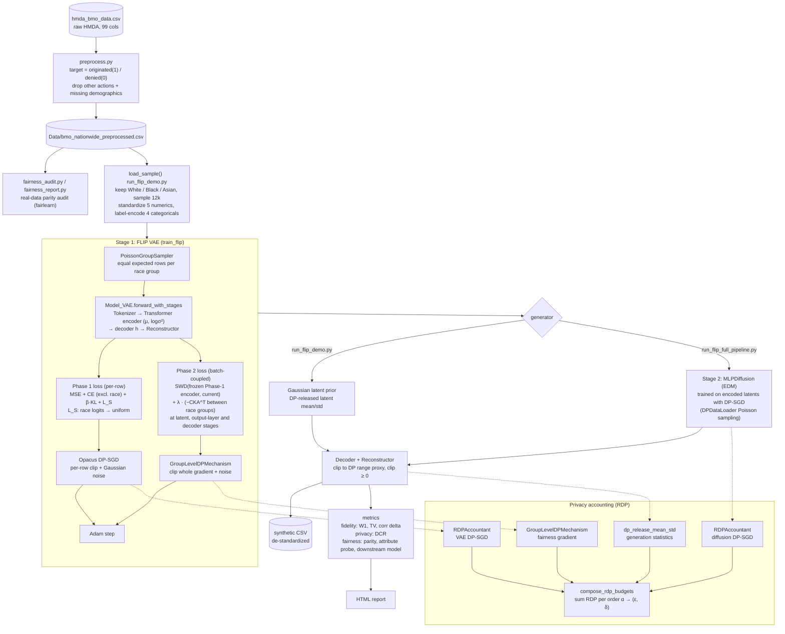

# Architecture: FLIP fair and private synthetic HMDA data

This repo implements **FLIP** (Fair Latent Intervention under Privacy guarantees, Zhang et al. 2025, arXiv:2508.21815) on top of **TabSyn** (a VAE plus latent diffusion generator for tabular data). The goal is synthetic mortgage-application data in which loan origination doesn't depend on race, trained under differential privacy (DP).

- **Vendored:** `tabsyn-main/tabsyn-main/` is upstream TabSyn, mostly unchanged.
- **Original work:**
  - `tabsyn/vae/flip_fairness.py`
  - `forward_with_stages()` in `tabsyn/vae/model.py`
  - the FLIP changes in `tabsyn/vae/main.py`
  - the top-level scripts
  - `tests/`

## Pipeline



### How the paper maps to the code

| Paper (FLIP) | Code |
|---|---|
| Balanced group sampling (Sec. 4.2.1, Eq. 11) | `PoissonGroupSampler` (default) and `BalancedGroupSampler` in `flip_fairness.py` |
| Uniform attribute loss L_S (Eq. 3) | `uniform_attribute_loss_per_sample` |
| Hilbert-Schmidt disentanglement, CKA^T (Eqs. 5–7) | `linear_cka_t` centers each row across activations (= A·H) and computes ⟨AᵀA, BᵀB⟩_F / (‖AᵀA‖‖BᵀB‖); `disentanglement_loss` averages −CKA^T over group pairs |
| Multi-stage intervention (Sec. 4.3.2) | `multi_stage_disentanglement_loss` over `mu_z`, per-feature output-layer logits (pre-aggregation for numerics), and decoder `h` |
| Divergence penalty D (Eq. 10) | `sliced_wasserstein_distance` at the latent and decoder stages against a frozen Phase-1 VAE |
| Task-agnostic fairness evaluation (Secs. 3.2.2, 5.3.2) | `fairness_eval.py`: BER, A-NCB, per-feature task fairness |
| DP-SGD with RDP accounting (Sec. 4.4) | Opacus `DPOptimizer` + `RDPAccountant`; `compose_rdp_budgets` for end-to-end ε |

## Module map

| File | Lines | Responsibility |
|---|---|---|
| `preprocess.py` | 41 | Raw HMDA → binary `target`; drops other actions and rows with missing demographics |
| `fairness_audit.py` | 134 | Real-data parity metrics per sensitive attribute and their combinations (console) |
| `fairness_report.py` | 370 | The same audit as an HTML report |
| `tabsyn/vae/flip_fairness.py` | 866 | All FLIP logic: losses, samplers, DP mechanisms, Opacus grad samplers for TabSyn modules, RDP accounting and composition |
| `tabsyn/vae/model.py` | — | Upstream VAE plus `forward_with_stages()`, which exposes latent, output-layer and decoder representations |
| `tabsyn/vae/main.py` | 526 | TabSyn's VAE trainer with an older FLIP loop. **Unused and not runnable** (issues #4–6, #14); only `compute_loss()` is imported by the live code |
| `fairness_eval.py` | — | The paper's fairness metrics: BER, A-NCB, per-feature task fairness (Eqs. 14/15), multi-group |
| `run_flip_demo.py` | 1,174 | Config (`TRADEOFF_PARAMS`), data loading, `train_flip`, Gaussian-prior generation, metrics, HTML report |
| `run_flip_full_pipeline.py` | 440 | Reuses the demo's Stage 1, adds a DP diffusion prior (Stage 2), decoding and composed ε |
| `tests/test_flip_fairness.py` | — | 71 unit tests for `flip_fairness.py` and `forward_with_stages` |
| `tests/test_metrics.py` | — | 9 tests for the demo's metric fixes and `fairness_eval.py` |
| `run_flip_demo_tmp.py` | 476 | Stale older copy of the demo. **Unused** |

## Code structure review

**What works well**
- The FLIP logic is kept in one library module (`flip_fairness.py`), separate from the scripts, and has good unit-test coverage.
- Docstrings explain the privacy reasoning: why the fairness terms can't go through DP-SGD, why Poisson sampling, and why ε values are composed in RDP rather than added.
- `run_flip_full_pipeline.py` reuses the demo's functions rather than copying them.

**Problems**
1. **Hardcoded Windows paths.** *Fixed:* `preprocess.py`, `fairness_audit.py` and `fairness_report.py` now default to repo-relative paths (they pointed to `c:\Users\db234\...`).
2. **Config lives in module-level dicts.** `TRADEOFF_PARAMS` and `DIFFUSION_PARAMS` are the scripts' defaults. *Addressed:* `configs/flip.yaml` plus `run_experiment.py` now drive every setting and path, with named experiments (see Running experiments). The scripts still run standalone with their built-in defaults.
3. **`run_flip_demo.py` does too much.** In 1,174 lines it mixes config, data loading, training, generation, five metric families, and about 200 lines of inline HTML. Split it into `data.py`, `train.py`, `generate.py`, `metrics.py` and `report.py`.
4. **Two copies of the training loop have drifted.** `train_flip()` (demo) and `main()` (`tabsyn/vae/main.py`) implement the same two-phase loop. The demo copy has fixes (clamps, Phase-2 LR drop, SWD cap, correct reference-encoder call) that the TabSyn copy lacks, and the TabSyn copy crashes. Keep one implementation.
5. **Tests stop at the library.** No test covers `train_flip`, `generate`, the metric functions, or the entry points. Every issue below that was confirmed by running would have been caught by a small smoke test on 200 rows.
6. **Repo hygiene.**
   - 40 `.pyc` files are tracked, so every test run dirties the tree.
   - `run_flip_demo_tmp.py` is a stale copy of the demo.
   - Generated reports (`fairness_report.html`, `flip_full_report.html`) are committed next to the code.
7. **Dependencies aren't declared.** There's no requirements file for the FLIP additions (torch, opacus, fairlearn). TabSyn's `requirements.txt` lists `zero`, which on PyPI is an unrelated package; the right one is `libzero`, which pins `torch<2` and must be installed with `--no-deps`.
8. **The real-data audit has no minimum group size.** In `fairness_audit.py`, the race parity ratio is reported as 0.00 because of a single-row "Free Form Text Only" group.

## Known issues

"Confirmed" means reproduced by running the code, on the HMDA data or on the stand-in data used in an earlier check.

| # | Severity | Issue | Location | Status |
|---|---|---|---|---|
| 1 | High | Numeric outputs are clipped at 0 while still standardized, so every below-average value becomes the real mean and the columns are nearly constant | `run_flip_demo.py:564`, `run_flip_full_pipeline.py:274` | Fixed (clip at −mean/std) |
| 2 | High | The downstream fairness probe includes the target in its features, so it reads back the real labels and can never detect bias | `run_flip_demo.py:745` | Fixed |
| 3 | High | `feats()` sizes one-hot encodings with `max()+1` separately for synthetic and real data, so the metric crashes when synthetic data never produces a category | `run_flip_demo.py:750,773` | Fixed |
| 4 | High | `tabsyn/vae/main.py` Phase 2: `ref_mu, _ = reference_encoder(...)` unpacks a single tensor | `tabsyn/vae/main.py:323` | Confirmed (`ValueError`) |
| 5 | High | `tabsyn/vae/main.py` Phase 2 without DP runs backward twice through a freed graph | `tabsyn/vae/main.py:340,361` | Confirmed (`RuntimeError`) |
| 6 | High | `tabsyn/vae/main.py` can't be launched: `utils.get_args()` lacks the FLIP flags and its `__main__` block never calls `main()` | `utils.py`, `tabsyn/vae/main.py:527` | Confirmed |
| 7 | High | L_S is summed over the batch while the other losses are means, so it outweighs reconstruction roughly batch-size times; under Opacus it dominates each row's clipped gradient | `flip_fairness.py:447` | Fixed (mean) |
| 8 | High | Privacy budget at the defaults is ε ≈ 175 per-row in Stage 1 alone (below), which gives no meaningful protection | `TRADEOFF_PARAMS` | Confirmed on HMDA |
| 9 | Medium | Statistics outside the privacy accounting: the full pipeline's latent `mean` and the demo's `num_means`/`num_stds`/median imputation come from raw data, and the column means and stds are embedded in the output CSV | `run_flip_full_pipeline.py:142`, `load_sample` | By reading the code |
| 10 | Medium | The HTML report's headline ε is the Stage-1 per-row ε, not the composed `eps_total` | `run_flip_demo.py:1149`, `run_flip_full_pipeline.py:433` | By reading the code |
| 11 | Medium | Under DP, Phase-2 fairness gradients (clipped to norm 0.5) get noise of std 1.5 on every parameter, so the fairness signal is mostly noise | `GroupLevelDPMechanism` | By reasoning, not measured |
| 12 | Medium | Parity metrics reward collapse: a generator that approves everyone scores a perfect ratio of 1.0 | `fairness_metrics` | Confirmed on HMDA |
| 13 | Low | CE is divided by a count that includes the skipped race column; DP `state_dict` keys carry an `_module.` prefix; unused `n_rows` argument; a "floor" comment on ceiling division | various | By reading the code |
| 14 | High | `tabsyn/vae/main.py:257` passes `verbose=True` to `ReduceLROnPlateau`, which torch 2.14 rejects (`TypeError`) | `tabsyn/vae/main.py:257` | Confirmed; not fixed (unused loop) |
| 15 | Medium | CKA^T centered each activation over samples (`dim=0`), discarding group means; the paper's CKA(Aᵀ,Bᵀ) centers across activations | `flip_fairness.py` `linear_cka_t` | Fixed |
| 16 | Medium | Paper deviations: numeric detokenizer stage used post-aggregation logits; SWD only at the latent stage; diffusion trained on μ instead of reparameterized latents | `flip_fairness.py`, `run_flip_demo.py`, `run_flip_full_pipeline.py` | Fixed |

Issues #4–6 and #14 are in the unused `tabsyn/vae/main.py` loop and are documented, not fixed. See `CHANGELOG.md` for every change.

## HMDA run results (2026-09-29)

> **Predates the fixes in `CHANGELOG.md`** (clip at the mean, summed L_S, CKA^T centering, report crash). The numbers below describe the code as it was then; rerun to get current results.

**Setup**
- **Input:** `hmda_bmo_data.csv`, 36,083 rows. `preprocess.py` reduces it to 28,142 rows; the White/Black/Asian filter leaves 24,701; the default `SAMPLE_SIZE` draws 12,000.
- **Code:** run exactly as committed, with all defaults except `DIFFUSION_PARAMS['EPOCHS'] = 10` (the default of 3,000 isn't feasible on CPU).
- **Runner:** paths were redirected to `runs/hmda/`, so no source file was changed.
- **Device:** CPU.

### Real data (target to match on fidelity, and to improve on fairness)

| Group | n | Origination rate |
|---|---|---|
| White | 20,414 | 0.610 |
| Asian | 3,089 | 0.537 |
| Black or African American | 1,198 | 0.432 |
| **Parity gap / ratio** | | **0.178 / 0.709** |

### Stage 1: FLIP VAE (identical in both pipelines, same seed)

- 160 epochs: 100 in Phase 1, 60 in Phase 2.
- Poisson sampling at 2 steps per epoch. The per-row inclusion probability is 0.592 for the smallest (Black) group.
- ε at δ = 1e-5:
  - Per-row (DP-SGD): **175.5**
  - Fairness-gradient mechanism: **33.0**
  - The composed total is higher still.

### Demo (Gaussian latent prior): `runs/hmda/flip_synthetic.csv`

The 12,000 synthetic rows were written. The script then **crashed in `_downstream_fairness`** (issue #3), so no HTML report exists. Scored independently:

| Measure | Real | Synthetic |
|---|---|---|
| Origination rate (all groups) | 0.59 | **1.00** (every row approved) |
| Race mix | 83% White / 13% Asian / 5% Black | 3% / **95%** / 1% |
| Loan product | 4 types | 100% "Conventional:Subordinate Lien" |
| Conforming limit | 90% C | 100% NC |
| Numeric spread (synthetic std / real std) | 1.0 | 0.00–0.05 |
| Parity ratio | 0.709 | 1.000 (only because every row is approved) |

The demo output has collapsed and isn't usable. The "perfect" parity is an artifact (issue #12). The likely causes are issues #7, #8 and #11: L_S dominates each row's clipped gradient, heavy DP noise over few steps, and a mostly-noise Phase-2 update. Issue #1 flattens the numerics further.

### Full pipeline (VAE + DP diffusion, 10 epochs): `runs/hmda/flip_full_synthetic.csv`

The run completed, including the HTML report (`runs/hmda/flip_full_report.html`). It took about 13 hours on CPU, almost all of it in the 10 DP diffusion epochs.

**Privacy (ε at δ = 1e-5)**

| Mechanism | ε |
|---|---|
| Stage 1 per-row DP-SGD | 175.5 |
| Stage 1 fairness-gradient mechanism | 33.0 |
| Stage 2 diffusion DP-SGD (10 epochs) | 3.3 |
| **Composed total** | **194.3** |

This composed total is also missing the statistics in issue #9, which were never accounted.

**Fairness and fidelity** (script metrics, plus an independent re-score of the CSV)

| Measure | Real | Synthetic |
|---|---|---|
| Origination: White / Asian / Black | 0.610 / 0.537 / 0.432 | 0.653 / 0.637 / 0.641 |
| **Parity gap / ratio** | **0.178 / 0.709** | **0.015 / 0.976** |
| Overall origination | 0.59 | 0.65 |
| Target distribution (TV distance) | — | 0.053 |
| Race mix | 83% White / 13% Asian / 5% Black | 50% / 22% / 28% |
| Loan product (TV) | — | 0.33 (73% "Subordinate Lien" vs 50% real) |
| Conforming limit | 90% C | 7% C, 65% NC, **28% "Missing"** |
| Numeric W1/std (mean of 5 columns) | — | 0.33 |
| Numeric spread (synthetic std / real std) | 1.0 | 0.00–0.30 |
| Correlation delta | — | 0.097 |
| DCR ratio | — | 1.99 (no sign of memorization) |

**How to read this**
- **Fairness:** unlike the demo, this parity result is genuine. Both outcomes occur in realistic proportions (65% originated, TV 0.05) and all three groups now have nearly equal approval rates. This is FLIP working as intended.
- **Race mix:** the uniform-attribute loss L_S pushes the protected attribute toward uniform, so group shares move from 83/13/5 toward balance. The paper intends this, but downstream users should know the synthetic data isn't demographically representative.
- **Fidelity:** numeric columns are poor.
  - Every column's minimum sits at or near the sample mean (issue #1), and spread is 0–30% of the real data's.
  - Loan-to-value averages 304 with a maximum of 832, which isn't plausible.
  - `conforming_loan_limit` is badly distorted, including an invented "Missing" level at 28%.
  - Ten diffusion epochs, against a default of 3,000, contributes too.
- **Privacy:** ε ≈ 194 is formally reported but gives no practical protection. The DCR ratio shows no copying of records, but that isn't a DP guarantee.

**Bottom line:** the full pipeline shows the fairness mechanism removes the race gap in approvals. The dataset isn't fit for release yet: the numeric columns are broken by issue #1, and the privacy budget is far from meaningful. Fixing issues #1, #7 and #8 (clip after de-standardizing, mean-reduce L_S, retune noise and epochs toward ε ≈ 10) is the next step.

## Reproducing

```bash
python3 -m venv .venv
.venv/bin/pip install torch opacus pytest numpy pandas scipy scikit-learn fairlearn tqdm pyyaml \
    icecream category_encoders tomli tomli-w pynvml
.venv/bin/pip install --no-deps libzero==0.0.8     # NOT `zero`: that PyPI package is unrelated
PYTHONDONTWRITEBYTECODE=1 .venv/bin/python -m pytest tests -q -p no:cacheprovider   # 80 pass
```

## Running experiments

See **[EXPERIMENTS.md](EXPERIMENTS.md)** for the full guide to running and adding experiments. In short, all settings live in [`configs/flip.yaml`](configs/flip.yaml):

- **`paths`:** raw data, preprocessed data, output directory.
- **`data`:** protected attribute, groups, columns.
- **`stage1`:** the FLIP VAE; maps to `TRADEOFF_PARAMS`.
- **`diffusion`:** Stage 2; maps to `DIFFUSION_PARAMS`.
- **`experiments`:** each experiment overrides only the keys it lists, and `extends:` layers one experiment on another. Unknown keys are rejected.

```bash
.venv/bin/python run_experiment.py --list                               # experiments
.venv/bin/python run_experiment.py --experiment eps_10 --predict-eps    # composed ε, no training
.venv/bin/python run_experiment.py --experiment smoke                   # all stages in ~1 min
.venv/bin/python run_experiment.py --experiment eps_10 --stages demo,full
```

- Stages run in order: `preprocess`, `audit`, `report`, `demo`, `full`.
- Outputs, plus a `resolved_config.yaml` recording every value used, go to `runs/<experiment>/`.
- A failing stage doesn't stop later ones.

`--predict-eps` uses the same accountants and step counts as training. It reproduced the recorded runs: 194.3 for `hmda_2026_09_29` and 23.1 for `smoke`.

| Experiment | What it changes | Predicted composed ε, demo / full (δ = 1e-5) |
|---|---|---|
| `baseline` | repo defaults | 197 / 261 |
| `hmda_2026_09_29` | diffusion epochs 10 (the recorded run) | 197 / 194 |
| `smoke` | 2 + 2 VAE epochs, 2k rows, 1 diffusion epoch | 28 / 23 (throwaway) |
| `no_dp` | DP off in both stages | none |
| `eps_10` | batch 96, σ 2.0, group σ 8, stats σ 10, diffusion σ 2.0, 10 epochs | 9.6 / 9.7 |
| `eps_6` | `eps_10` with σ 3.0 | 6.3 / 6.4 |
| `eps_10_strong_fairness` | `eps_10` with λ_fair 5.0 | 9.6 / 9.7 |
| `eps_10_full_data` | `eps_10` on all ~24.7k rows | 6.5 / 6.5 |

The main privacy lever is batch size. The smallest group (576 rows in the 12k sample) is included in a 1,024 batch with probability 0.59 per step; at batch 96 that drops to 0.056. None of these ε values cover the statistics in known issue #9.
