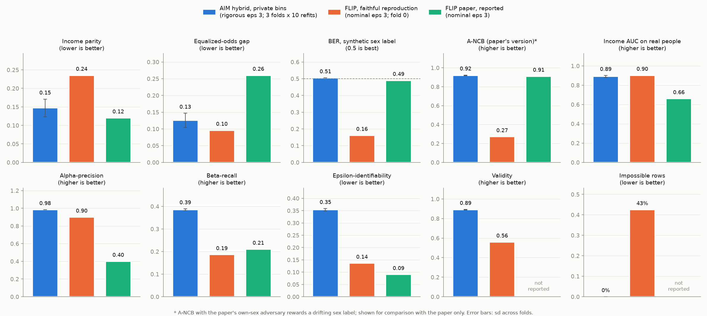

# Final result: AIM hybrid vs FLIP (UCI Adult, epsilon 3)



| Metric | AIM hybrid, private bins | FLIP, faithful reproduction | FLIP paper, reported |
|---|---|---|---|
| Privacy | **rigorous eps 3 (whole release)** | nominal eps 3 (VAE only) | nominal eps 3 (VAE only) |
| Income parity (lower better) | 0.147 ± 0.024 | 0.235 | **0.12** |
| Equalized-odds gap (lower better) | 0.126 ± 0.021 | **0.096** | 0.26 |
| BER, synthetic sex label (0.5 best) | **0.505** | 0.162 | 0.49 |
| A-NCB, paper's own-sex version (higher better)* | **0.92** | 0.27 | 0.91 |
| Release teaches real sex, folded tstr (0.5 best) | **0.434** | 0.168 | not reported |
| Income AUC on real people (higher better) | 0.890 | **0.902** | 0.66 |
| Alpha-precision (higher better) | **0.984** | 0.900 | 0.40 |
| Beta-recall (higher better) | **0.385** | 0.186 | 0.21 |
| Validity (higher better; real 0.98) | **0.890** | 0.559 | not reported |
| Impossible rows (lower better; real 0%) | **0%** | 43% | not reported |
| Epsilon-identifiability (lower better) | 0.354 | 0.136 | **0.09** |

Notes on the three columns:

- **AIM hybrid:** 3 folds × 10 refits; ± is the sd across folds.
- **FLIP reproduction:** FLIP as published, lambda 4, fold 0. It uses the
  paper-closest setup of `scripts/run_heatmap_fold0.sh`, scored from its
  released table like AIM.
- **FLIP paper:** values read off its Fig. 3 (Adult, lambda 4, eps 3),
  produced by its own evaluation code, so not strictly comparable.

\* A-NCB with the paper's own-sex adversary rewards a drifting sex label,
and on Adult it reduces to one married/not-married split. It is shown only
because the paper uses it.

## What it shows

- **The AIM hybrid is the only method whose privacy claim holds.** Every
  fairness and realism step is post-processing of AIM's noisy measurements,
  and the numeric bins are learned inside the budget.
- **Our FLIP reproduction never removes the unfairness.**
  - Income parity stays at 0.235, the level with no fairness term at all.
  - The released sex label stays learnable (BER 0.16, tstr 0.17).
  - 43% of its rows are impossible.
- **The paper's FLIP numbers come with a large utility cost.** Its reported
  parity (0.12) is the best, but at AUC 0.66 and alpha-precision 0.40. Its
  reported EO gap is the worst (0.26). It reports no realism or real-leakage
  measure.
- **AIM's weak spot is equalized odds.** The FLIP reproduction's EO gap is
  lower (0.096 vs 0.126), but with parity at 0.235. The remaining gap comes
  from "married": it stays a real-world proxy even after masking.

## Why AIM's epsilon-identifiability is the highest despite formal privacy

Epsilon-identifiability is the share of real people whose nearest synthetic
row is closer than their nearest other real person. It measures **closeness
to real rows, not leakage**, so it rewards realism and penalizes noise:

- AIM samples from a model of the population. Realistic rows land in dense
  regions near many real people, so the score is high: 0.35, and 0.43 for
  plain AIM, the most realistic table. That isn't a leak. DP guarantees the
  same rows would have been generated, with almost the same probability,
  whether or not any one person was in the data.
- FLIP scores low (0.09–0.14) because its rows are far from everyone:
  alpha-precision 0.40–0.90 and 43% impossible rows. Low scores here partly
  reflect unrealistic data, not better privacy.
- The metric comes from non-DP generator papers, where no formal guarantee
  exists. With AIM's formal epsilon 3, it is a realism diagnostic, not the
  privacy measure.

## Public vs private bins

The AIM hybrid with the fixed public bins scores slightly better income
parity (0.135 vs 0.147), with the same EO, AUC and validity. But its numeric
values are less realistic (W1 0.045 vs 0.024), and part of that parity edge
comes from the blurring. See the README.

## Reproduce

```bash
bash aim_fair/run_final.sh                       # AIM hybrid, 3 folds
bash scripts/run_heatmap_fold0.sh                # FLIP reproduction runs
python run_adult_flip.py --score-csv adult_results/hm_e3_lam4_argmax_synthetic.csv \
    --fold 0 --score-collapsed --no-save-run --tag flipfaithful_e3_f0_lam4
python aim_fair/final_chart.py                   # results/final_comparison.{png,csv}
```

The comparison with our own FLIP variant (VAE + joint fairness stage) is in
`aim_fair/FINAL_COMPARISON.md`.
