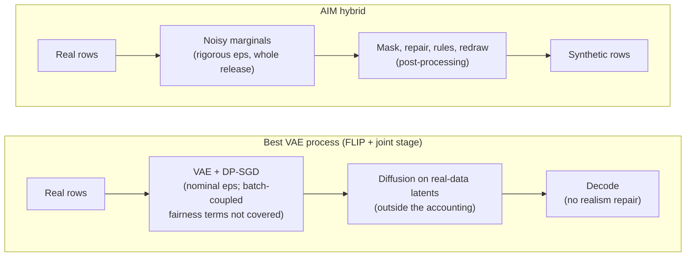

# AIM hybrid: architecture

The real data is touched only inside the **privacy boundary**, AIM's
measuring loop, which spends the whole (epsilon, delta) budget. Everything
after the noisy measurements is post-processing. It reads only those
measurements or a model fitted to them, so it costs no budget, and any
number of refits or variants can come from one private release.

```mermaid
flowchart TD
    REAL[("Real Adult fold<br/>(training rows)")]
    SCHEMA["Public schema<br/>fixed bin edges, category lists<br/><i>adult_domain.py</i>"]

    subgraph DP["Privacy boundary: zCDP, epsilon = 3, delta = 1e-5"]
        direction TB
        SEL["Select a 1- or 2-way marginal<br/>(exponential mechanism)"]
        MEAS["Measure its counts<br/>+ Gaussian noise"]
        FIT0["Refit Private-PGM<br/>(Mirror Descent)"]
        SEL --> MEAS --> FIT0 -->|"budget left"| SEL
    end

    NOISY[("Noisy measurements<br/>~70 count tables, saved<br/><i>aim_e3_fF_measurements.pkl</i>")]

    subgraph PP["Post-processing: no privacy cost (FairAIM.synthesize)"]
        direction TB
        RAW["Fit model to noisy tables"]
        MASK["1 Proxy masking<br/>levels with P(sex | level) >= 0.95,<br/>pointing to different sexes, are merged<br/>(Husband + Wife -> MASK)<br/><i>detect_proxy_classes_model, merge_categories</i>"]
        RULES["Consistency rules<br/>pre-specified test on non-sex 2-way tables:<br/>true count < 10% of independence,<br/>95% family-wise (Bonferroni)<br/><i>tested_pair_rules</i>"]
        PLANS["2 Repair plans<br/>per column and sex: transport<br/>P(column | sex) -> pooled P(column)<br/>(quantile coupling for bins, minimal move for categories)<br/><i>repair_plans</i>"]
        PUSH["Push every table through the plans<br/>tables with sex: exact per sex slice<br/>tables without sex: plan mixed by P(sex | x)<br/><i>repair_measurements</i>"]
        FIT["Final Private-PGM fit<br/>on the repaired tables"]
        SAMPLE["Sample rows"]
        REDRAW["3 Pair redraw<br/>rows breaking a rule: redraw only the broken pair<br/>from the model conditional, banned cells excluded<br/><i>gibbs_fix</i>"]
        MATCH["4 Marginal check<br/>re-match columns that drifted > 0.2 pts<br/><i>match_marginals</i>"]
        RAW --> MASK --> PLANS --> PUSH --> FIT --> SAMPLE --> REDRAW --> MATCH
        MASK --> RULES
        RULES --> REDRAW
    end

    DECODE["Decode bins to values<br/><i>adult_domain.decode</i>"]
    OUT[("Synthetic table<br/><i>aim_e3_fF_rR_synthetic.csv</i>")]
    SCORE["Score with the VAE's metrics<br/><i>run_adult_flip.py --score-csv --mask-proxies</i>"]
    CMP["AIM vs VAE table<br/><i>summarize.py -> FINAL_COMPARISON.md</i>"]

    REAL --> DP
    SCHEMA --> DP
    SCHEMA --> PP
    DP --> NOISY --> PP
    PP --> DECODE --> OUT --> SCORE --> CMP

    classDef priv fill:#fde8e8,stroke:#c0392b,color:#1a1a1a
    classDef free fill:#e8f4ea,stroke:#2e7d32,color:#1a1a1a
    classDef data fill:#eef2fb,stroke:#3949ab,color:#1a1a1a
    class SEL,MEAS,FIT0 priv
    class RAW,MASK,RULES,PLANS,PUSH,FIT,SAMPLE,REDRAW,MATCH free
    class REAL,NOISY,OUT data
```

## Components

| Step | What it does | Code |
|---|---|---|
| Public schema | Fixed bin edges and category lists, not learned from the data, so they need no budget | `adult_domain.py` |
| AIM measuring | Adaptively selects marginals and measures them with Gaussian noise under zCDP; saves the noisy tables | `FairAIM.run` (AIM, McKenna et al. 2022) |
| 1 Proxy masking | Merges category levels that encode sex by definition, read from the measured noisy sex × column tables | `detect_proxy_classes_model`, `merge_categories` |
| 2 Repair | Moves every column's per-sex distribution, income included, to the pooled one (Feldman et al. 2015, applied to the tables), then refits | `repair_plans`, `repair_measurements` |
| Consistency rules | Finds structurally impossible value pairs from the noisy tables with a test fixed in advance | `tested_pair_rules` |
| 3 Pair redraw | Fixes rule-breaking rows by redrawing only the broken pair from the model; the rest of the row is kept | `gibbs_fix` |
| 4 Marginal check | Undoes the drift the redraw causes in 1-way distributions (e.g. the >50K rate) | `match_marginals` |
| Decode and score | Turns bins into values; scores with exactly the VAE's metrics | `adult_domain.decode`, `run_adult_flip.py --score-csv` |

Entry points: `run_aim.py` (one fold: measure, then refits) and
`run_final.sh` (3 folds, the plain-AIM baseline, scoring and the summary).

## Contrast with the VAE pipeline

In the VAE, fairness is a training loss inside the private mechanism, so
its privacy has to be accounted there. In the AIM hybrid, fairness and
realism act after the mechanism, on the noisy tables, so they never touch
the guarantee.
